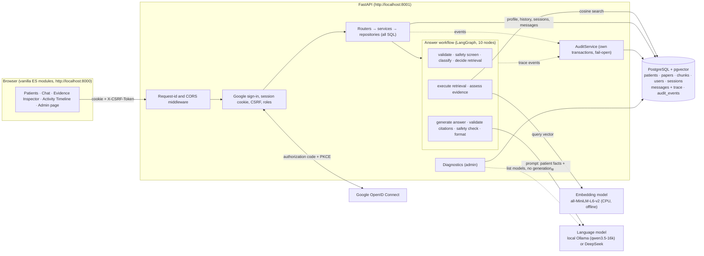

# Architecture

MindEvidence Lab is an **educational prototype** with **synthetic patients**: a small, local, development-only system that
answers students' questions about addiction-treatment cases with traceable citations. It is not production-ready and not
clinically validated. Gmail/e-mail reporting from the original spec was deliberately **not implemented**; nothing below sends
e-mail.

## The system at a glance



Plain-text version of the same picture:

```
 Browser (localhost:8000)  --cookie + CSRF-->  FastAPI (localhost:8001)
   patients, chat, evidence,                     |-- middleware: request id, CORS (explicit origins)
   timeline, admin page                          |-- auth: Google OIDC (PKCE) -> server session cookie, CSRF, roles
                                                 |-- routers -> services -> repositories (all SQL) -> PostgreSQL + pgvector
                                                 |-- answer workflow (LangGraph, 10 nodes)
                                                 |     validate -> safety screen -> classify -> decide retrieval
                                                 |        -> [retrieval: embed query (MiniLM, CPU) -> cosine search in pgvector]
                                                 |        -> assess evidence -> generate (LLM) -> validate citations
                                                 |        -> safety check -> format output
                                                 |-- AuditService: append-only audit_events in its own transactions
                                                 `-- diagnostics (admin): checks without secrets
 Google ........ sign-in only (scopes: openid email profile)
 LLM ........... local Ollama on this machine (default here) or the DeepSeek API; called only from the backend
```

## Data flow of one question

`POST /api/sessions/{id}/messages` with `{content, mode}` (modes: `general_knowledge`, `rag`, `both`):

1. **Browser → API.** The page sends the session cookie, the `X-CSRF-Token` header (value from `/api/auth/me`) and a fresh
   `Idempotency-Key`. Middleware gives the request an id (`X-Request-ID`).
2. **Authentication and ownership.** The cookie token is hashed and looked up; expired sessions are deleted. A POST needs the
   CSRF token and an allowed `Origin`. Another user's chat session is a `404`, never a `403`.
3. **Phase A, one short database transaction.** Ownership, idempotency lookup (a repeated key replays the stored answer, no
   second model call), the **patient context** (profile and history of the chosen synthetic patient), the last turns, the
   per-user rate limit. The connection is then released. `question_submitted` goes to the audit log.
4. **Phase B, the LangGraph workflow, no database connection held** (a local model can take minutes):
   * *validate inputs*, *safety screen* (first-person crisis cues stop here: fixed notice, no model);
   * *classify intent* (rule-based: unsupported request, comparison, patient-history lookup, research question; diagnosis,
     dosing and other-patient requests stop here: no model);
   * *decide retrieval* (deterministic: `general_knowledge` never retrieves; history questions are answered from the patient
     facts; research and comparison questions retrieve);
   * *execute retrieval*: the query is embedded (MiniLM, CPU, offline) and compared by cosine distance with the embedded chunks
     in **pgvector**; chunks below the similarity threshold are dropped; chunks flagged `possible_injection` are never shown to
     the model;
   * *assess evidence*: none → the run ends with the fixed **no-evidence** answer, **no model call**; weak or adequate → go on
     (a short follow-up with no evidence gets one more search with the previous question added);
   * *generate answer*: the prompt holds the rules, the patient facts and the numbered evidence blocks as **untrusted data**; the
     model returns JSON sections; one repair attempt if the JSON is invalid;
   * *validate citations*: every alias must map to a chunk that was shown; every quote is checked against that chunk; claims
     without a valid citation are reported as unsupported; dosing instructions and treatment directives are withheld;
   * *safety check* and *format output*: escalation notice if needed, the response and the statistics-only **trace** are built.
5. **Phase C, one short transaction.** The user message and the assistant message (with the structured response and the trace)
   are stored. Nothing is stored if any earlier step failed.
6. **Audit.** The node trace, retrieval, model request (model name, token counts), citation counts and the outcome or the error
   code are written in **separate audit transactions** under one server-generated correlation id (`docs/OBSERVABILITY.md`).
   Audit events hold metadata only.
7. **API → browser.** The structured answer (sections, citations with verification flags, evidence, unsupported claims,
   trace). The page shows it with `textContent` only; the Activity Timeline reads the audit log.

## Layers and where things live

| Layer | Where | Notes |
|-------|-------|-------|
| Frontend | `frontend/` | vanilla HTML/CSS/ES modules, no framework; `js/api.js` is the only data-access file |
| Routers | `backend/app/routers/` | HTTP only; standard error format `{"error": {code, message, request_id}}` |
| Services | `backend/app/services.py`, `app/answers/`, `app/audit/` | business rules; no SQL |
| Repositories | `backend/app/repositories/` | all SQL |
| Workflow | `backend/app/graph/` | typed LangGraph state, deterministic routing, guarded nodes |
| LLM client | `backend/app/llm/` | provider interface, prompt builder, sanitizer, citation validator, safety rules |
| Retrieval | `backend/app/retrieval/`, `app/embedding/`, `app/ingestion/` | PDF → chunks → embeddings → cosine search |
| Database | `backend/db/`, `backend/alembic/` | SQLAlchemy models, 8 migrations, seed |
| Diagnostics, evaluation | `app/diagnostics/`, `app/eval_*.py` | operator checks; comparative evaluation |

## Trust boundaries

* Retrieved document text, chat text and model output are **untrusted data**: they never change routing, never act as
  instructions, and are rendered as text.
* Secrets live in the server's environment only (never in the frontend, responses, logs or the audit table; tests assert this).
* The language model only writes; the code decides what is retrieved, what is sent, what is accepted and what is stored.

## Endpoints

This table is checked against `/openapi.json` by a test (`tests/test_architecture_doc.py`): if an endpoint is added or removed
without updating this table, the test fails.

<!-- endpoints:start -->
| Method | Path | Area | Summary |
|--------|------|------|---------|
| GET | `/api/health` | health | Health check |
| GET | `/api/auth/google/callback` | auth | Google redirects back here |
| GET | `/api/auth/google/login` | auth | Start Google sign-in |
| POST | `/api/auth/logout` | auth | Sign out |
| GET | `/api/auth/me` | auth | Who am I |
| GET | `/api/patients` | patients | List synthetic patients |
| GET | `/api/patients/{patient_id}` | patients | Get a patient profile |
| GET | `/api/patients/{patient_id}/history` | patients | Get a patient's chronological history |
| GET | `/api/papers` | papers | List research papers (metadata only) |
| GET | `/api/sessions` | sessions | List chat sessions |
| POST | `/api/sessions` | sessions | Create a chat session |
| GET | `/api/sessions/{session_id}` | sessions | Get one chat session |
| GET | `/api/sessions/{session_id}/messages` | sessions | List the messages of a chat session |
| POST | `/api/sessions/{session_id}/messages` | sessions | Ask a question in a chat session |
| POST | `/api/sessions/{session_id}/messages/{message_id}/feedback` | sessions | Rate an answer |
| GET | `/api/sessions/{session_id}/messages/{message_id}/trace` | sessions | Get the workflow trace of an answer |
| POST | `/api/retrieval/search` | retrieval | Search the research documents |
| GET | `/api/audit/timeline` | audit | Activity timeline of one of your chat sessions |
| GET | `/api/admin/audit/events` | admin | List audit events (admin) |
| GET | `/api/admin/audit/summary` | admin | Audit statistics (admin) |
| GET | `/api/admin/chunks/{chunk_id}` | admin | One chunk with its full text (admin) |
| GET | `/api/admin/diagnostics` | admin | Operator diagnostics (admin) |
| GET | `/api/admin/papers` | admin | List papers with ingestion status (admin) |
| GET | `/api/admin/papers/{paper_id}` | admin | One paper with ingestion details (admin) |
| GET | `/api/admin/papers/{paper_id}/chunks` | admin | List the chunks of a paper (admin) |
<!-- endpoints:end -->

Every route except `/api/health` and `/api/auth/*` needs a signed-in session; `/api/admin/*` needs the admin role (401 when
signed out, 403 for students). Details: `docs/API.md`, `docs/API_ACCESS_POLICY.md`.
