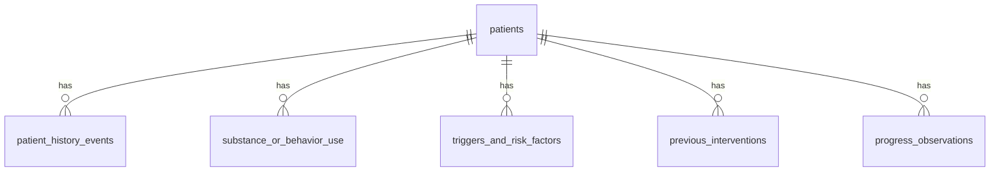

# Data dictionary: synthetic patient database (Batch 02)

All data here is **fictional**. Patient tables hold **patient facts only**: no research claims, citations, or model interpretations. Users, sessions, documents and logs live in separate tables added in later batches.

Every table has `is_synthetic boolean NOT NULL DEFAULT true` with `CHECK (is_synthetic)`, so a non-synthetic row cannot be stored.
Every date column has `CHECK (date <= CURRENT_DATE)`. (`CURRENT_DATE` is not an immutable expression; that is allowed in a CHECK and is documented here on purpose.)
"Unknown" is always written explicitly (`'unknown'` or a sentence such as "Family history: unknown"), never left silently empty.

Record ids are text keys built from the patient id and the position in the seed file, for example `P-001-H03`. A CHECK on each child table makes sure the key prefix matches its patient. That makes seeding deterministic and idempotent.

All five child tables reference `patients.patient_id` with `ON DELETE CASCADE`.

## patients
One row per synthetic patient.

| Column | Type | Purpose / rules |
|--------|------|-----------------|
| `patient_id` | text, PK | `P-001` .. `P-010`. CHECK `~ '^P-[0-9]{3}$'`. The only identifier; no names. |
| `age_at_intake` | smallint | Age instead of date of birth. CHECK 18..110 (adults only). |
| `gender` | text | `woman`, `man`, `non_binary`, `other`, `unknown`. |
| `primary_category` | text | `alcohol`, `cannabis`, `opioids`, `stimulants`, `behavioral`. A label for grouping, not a statement about suitable treatment. |
| `intake_date` | date | Date of the case intake. Not in the future. All progress observations are on or after it. |
| `living_situation` | text | Housing and household, or `unknown`. |
| `employment_status` | text | Work or study situation, or `unknown`. |
| `social_context` | text | Relationships and settings that matter for the case. |
| `co_occurring_symptoms` | text | Other reported symptoms (for example sleep difficulty), or "none reported" / "unknown". |
| `motivation_at_intake` | text | `none_expressed`, `ambivalent`, `contemplating`, `preparing`, `engaged`, `unknown`. |
| `background` | text | Short fictional background. |
| `history_summary` | text | One or two sentences summarizing use history. Must agree with the detail tables. |
| `treatment_summary` | text | One or two sentences summarizing past and current contact with services. Must agree with `previous_interventions`. |
| `is_synthetic` | boolean | Always true. |
| `created_at`, `updated_at` | timestamptz | Row timestamps. `updated_at` changes only when the seed content changes. |

## patient_history_events
Dated life and use events: the backbone of each timeline.

| Column | Type | Purpose / rules |
|--------|------|-----------------|
| `event_id` | text, PK | `P-001-H01`, ... in chronological order. |
| `patient_id` | text, FK | Owner patient. |
| `event_date` | date | When it happened. For `year`/`month` precision the first day of that period is stored. |
| `date_precision` | text | `year`, `month`, `day`: how exact the date is. |
| `event_type` | text | `onset`, `escalation`, `life_event`, `health_event`, `legal_or_work_event`, `help_seeking`, `treatment_contact`, `reduction_attempt`, `relapse`, `recovery_milestone`, `other`. |
| `description` | text | Non-instructional description of the event. |

Seed rules checked by tests: the first event is the `onset` and matches the start of the primary use record; every intervention start date has a matching day-precision `treatment_contact` event.

## substance_or_behavior_use
What the patient uses or does, and how that pattern changed.

| Column | Type | Purpose / rules |
|--------|------|-----------------|
| `use_id` | text, PK | `P-001-U01`, ... |
| `patient_id` | text, FK | Owner patient. |
| `category` | text | Same values as `patients.primary_category`. |
| `substance_or_behavior` | text | Plain name, for example "Alcohol" or "Online sports betting". |
| `pattern` | text | `daily`, `several_per_week`, `weekends`, `binge_episodic`, `intermittent`, `unknown`. |
| `start_date` | date | When the pattern began. |
| `end_date` | date, nullable | End of the pattern. NULL means ongoing. CHECK `>= start_date`; allowed only when `status` is `abstinent` or `unknown`. |
| `status` | text | `active`, `reduced`, `supervised` (use within a supervised arrangement), `abstinent`, `unknown`. |

The latest progress observation must agree with this status (checked by a test).

## triggers_and_risk_factors
Context around the patient's use.

| Column | Type | Purpose / rules |
|--------|------|-----------------|
| `factor_id` | text, PK | `P-001-F01`, ... |
| `patient_id` | text, FK | Owner patient. |
| `kind` | text | `trigger`, `risk_factor`, `protective_factor`, `observed_behavior`. |
| `context` | text | `emotional`, `social`, `work`, `financial`, `health`, `environmental`, `unknown`. |
| `description` | text | What the factor is. Unknown items say so explicitly. |

Every patient has at least one `trigger`. These are descriptions of the case, not claims about causes.

## previous_interventions
Contact with services, as it happened.

| Column | Type | Purpose / rules |
|--------|------|-----------------|
| `intervention_id` | text, PK | `P-001-I01`, ... |
| `patient_id` | text, FK | Owner patient. |
| `intervention_type` | text | `brief_advice`, `outpatient_counseling`, `group_support`, `residential_program`, `medication_supported_program`, `inpatient_stay`, `pain_management_program`, `self_exclusion_or_blocking`, `family_sessions`, `other`. |
| `setting` | text | Where it took place. |
| `start_date` | date | Start. |
| `end_date` | date, nullable | End. CHECK `>= start_date`. |
| `completion_status` | text | `completed`, `dropped_out`, `ongoing`, `not_started`, `unknown`. CHECK: `ongoing` has no end date; `completed`/`dropped_out` have one. |
| `reported_outcome` | text | What happened to the patient (attendance, what they did afterwards). It never states that an approach works or is best. |

## progress_observations
Check-ins after intake.

| Column | Type | Purpose / rules |
|--------|------|-----------------|
| `observation_id` | text, PK | `P-001-O01`, ... in chronological order. |
| `patient_id` | text, FK | Owner patient. |
| `observed_on` | date | Date of the check-in. On or after `intake_date`. |
| `use_status` | text | `abstinent`, `reduced`, `unchanged`, `increased`, `relapse`, `unknown`. |
| `motivation` | text | Same values as `motivation_at_intake`. |
| `note` | text | Short factual note. |

## Indexes
`(patient_id, event_date)`, `(patient_id, start_date)` (use and interventions), `(patient_id, kind)` (factors), `(patient_id, observed_on)` (progress). Each starts with `patient_id`, so patient lookups are covered.

## Sample queries
- `backend/db/queries/patient_profile.sql`: one patient plus all related records as JSON arrays.
- `backend/db/queries/patient_history.sql`: one patient's chronological history across all tables.

Both take the named parameter `:patient_id`.

## Content rules for the seed files
No names, contact data or links. No substance preparation or dosing, no methods of self-harm. No treatment recommendations or "best treatment" statements. No research findings or citations. A test scans the seed text for emails, phone numbers, links and a list of instructional or advisory words.

---

# Added in Batch 03 (migration 0002)

These tables are **not patient data**. They are separate from the six patient tables above. Nothing in them is a research claim yet.

## papers
Metadata for the research corpus. No document text and no chunks (Batch 05), and no file path is stored.

| Column | Type | Purpose / rules |
|--------|------|-----------------|
| `paper_id` | text, PK | Stable slug, for example `who-mhgap-guideline-2023`. CHECK `~ '^[a-z0-9][a-z0-9-]*$'`. |
| `title` | text | Title as written in the project's corpus list. Not blank. |
| `document_type` | text | `guideline`, `guide`, `review`, `unknown`. Taken from the title only. |
| `publisher` | text | For example `WHO` or `NIDA`, or the explicit text `unknown`. |
| `publication_year` | text | Four digits or the explicit text `unknown` (CHECK `~ '^(unknown\|[0-9]{4})$'`). Text, so "unknown" is a real value. |
| `source_note` | text | Where the metadata came from and that it was not verified against the document. |
| `ingest_status` | text | `not_ingested` (default), `ingested`, `failed`. Changed by Batch 05. The seed never resets it. |
| `created_at` | timestamptz | Row creation time. |

Seeded from `backend/db/seed_data/papers.json` (4 papers). The fourth is a psychosocial-interventions review, not the Cochrane review named in `docs/SPEC.md`.

## chat_sessions
A conversation about one patient. Named `chat_sessions` so it is never confused with the sign-in session of Batch 04.

| Column | Type | Purpose / rules |
|--------|------|-----------------|
| `session_id` | uuid, PK | Generated by the database (`gen_random_uuid()`). |
| `patient_id` | text, FK to `patients` | `ON DELETE RESTRICT`: a patient who has sessions cannot be deleted by accident. |
| `title` | text | 1 to 120 characters after trimming. |
| `owner_id` | uuid, nullable | Reserved for Batch 04. No foreign key yet; always null for now. |
| `created_at` | timestamptz | Creation time. |

## chat_messages
Messages inside a chat session. Nothing writes to this table in Batch 03.

| Column | Type | Purpose / rules |
|--------|------|-----------------|
| `message_id` | uuid, PK | Generated by the database. |
| `session_id` | uuid, FK to `chat_sessions` | `ON DELETE CASCADE`: messages are removed with their session. |
| `role` | text | `user` or `assistant`. |
| `mode` | text, nullable | `general_knowledge`, `rag`, `both`, or NULL (for example for user messages). |
| `content` | text | Not blank, at most 8000 characters. |
| `created_at` | timestamptz | Used for ordering (`created_at`, then `message_id`). |

Indexes: `chat_sessions (patient_id, created_at)` and `chat_messages (session_id, created_at)`.

## Changes to existing query files
`backend/db/queries/patient_history.sql` now also returns `date_precision` (set for history events, NULL for other rows) so the frontend can format "Sep 2012" correctly.
