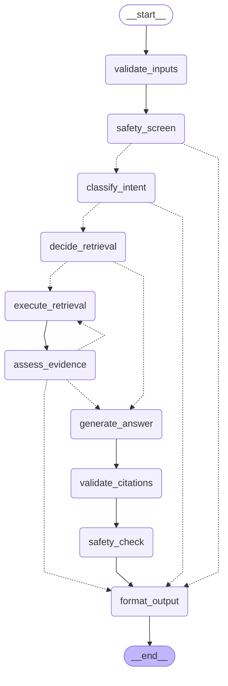

# Answer workflow (Batch 08)

The Batch 07 answer pipeline is now an explicit, typed **LangGraph** state graph (`backend/app/graph/`). It is a restructuring, not new behaviour: the same safety screen, retrieval, prompt builder, model call, citation validation and storage run inside named nodes, and every Batch 07 test still passes (with the few declared changes below). What is new is that the route of each question is **decided by deterministic code**, can be tested node by node, and is **recorded** as a statistics-only trace.

Nothing here makes the system clinically validated or ready for production.

## The graph

Compiled once at startup. The drawing below is produced from the **compiled** graph (`python -m app.graph --diagram`; the checked-in copy is `docs/orchestration.mmd` and a test fails if they differ).



Dotted arrows are conditional routes. There is **no checkpointer** (LangGraph keeps nothing about a run), **no LangSmith / LangChain tracing** (forced off when the package is imported) and no network use by the graph itself (a test blocks Python-level connections while it runs). LangGraph is used only as a state-machine runner.

## State (`app/graph/state.py`, Pydantic v2)

| Group | Fields |
|-------|--------|
| inputs | `user_id`, `session_id`, `patient_id`, `mode`, `question`, `request_id`, `patient_profile` (the patient record read by the service), `history` (recent turns) |
| decisions | `safety`, `classification {label, reason_code}`, `retrieval_decision {needed, reason_code, reason}`, `evidence_assessment {sufficient, level, reason_code, counts}`, `termination {reason_code, message}` |
| working data | `retrieval_query`, `attempts`, `evidence` (retrieved chunks), `raw_answer`, `validated`, `citation_validation`, `generation`, `flags` |
| output | `result` (set by `format_output`) |
| append-only | `execution_trace` and `user_trace` (reducer: concatenation, nodes only add) |

Dependencies (database engine, settings, model client, embedder, deadline) travel in the LangGraph **config**, never in the state, so the state holds no key, token or database session. Chunk and patient text may sit in memory during a run; the state as a whole is never persisted or traced.

## Nodes and routes

| # | Node | What it does (existing code reused) | Next |
|---|------|--------------------------------------|------|
| 1 | `validate_inputs` | question length, mode and patient record present (ownership and the patient record are read by the service in its first short database phase) | `safety_screen` |
| 2 | `safety_screen` | `safety.screen_question`; a first-person crisis statement ends the run with the fixed notice | crisis: `format_output`; else `classify_intent` |
| 3 | `classify_intent` | deterministic classifier (below); unsupported requests end the run | unsupported: `format_output`; else `decide_retrieval` |
| 4 | `decide_retrieval` | routing table (below) | needed: `execute_retrieval`; else `generate_answer` |
| 5 | `execute_retrieval` | the Batch 06 search, called directly (own short read-only database session; not through HTTP, not charged to the search rate limit) | `assess_evidence` |
| 6 | `assess_evidence` | deterministic evidence assessment (below) | sufficient: `generate_answer`; insufficient follow-up with attempts < 2: `execute_retrieval` (once); else `format_output` (`no_evidence`, **no model call**) |
| 7 | `generate_answer` | prompt builder, sanitizer, model call, one repair | `validate_citations` |
| 8 | `validate_citations` | alias to chunk id, quote check, unsupported claims, mode rules, dosing and directive withholding (`validate_answer`) | `safety_check` |
| 9 | `safety_check` | decides the escalation notice (risk cues in the question or the model's flag) and records what was withheld | `format_output` |
| 10 | `format_output` | builds the stored response, the message text and the complete trace (adds `skipped` entries) | end |

The model never chooses a route. The only loop is `assess_evidence` to `execute_retrieval`, bounded by `attempts < 2`; LangGraph's recursion limit is also set (25, the longest legitimate path has 12 steps).

### Routing table (`decide_retrieval`)

| mode | classification | retrieval | `reason_code` |
|------|----------------|-----------|---------------|
| any | `unsupported_request` | none: the run ended earlier, **no model call** | (`classify_intent` ended) |
| `general_knowledge` | history, research, comparison | no | `mode_forbids_retrieval` |
| `rag`, `both` | `patient_history_lookup` | no: answered from the patient facts only | `history_question_answered_from_patient_facts` |
| `rag`, `both` | `research_question`, `comparison` | yes | `research_needs_evidence` |
| `rag`, `both` | uncertain | yes (safe default) | `uncertain_default_retrieve` |

A history answer adds one more rule file to the system message (`prompts/mode_patient_facts.txt`: answer only from `<patient_facts>`, cite nothing). The prompt version string stays `answer-v1`.

### Classifier (`app/graph/classifier.py`)

Rule-based, NFKC-normalised, never raises, never sees retrieved text (so injected chunk text cannot change a route). Order of the rules: `unsupported_request` (diagnosis requests, dosing or prescribing, an individual treatment choice for the patient, another patient or "all patients", real people or first-person real life, an explicit off-topic list such as recipes, football, bitcoin, requests to write code) > `comparison` (compare, versus, "how does X apply to this patient", a patient reference together with a research cue) > `patient_history_lookup` (patient reference plus a case-fact cue, no research cue) > default `research_question`. It is deliberately conservative: an unclear question is **searched** (so "completely unrelated words about cooking" still ends as no-evidence, as in Batch 07), and **instruction-override text is not blocked here**: Batch 07's prompt design (untrusted text confined to the `<question>` block, system message never changed) stays the control for it.

**Honest limits.** It matches **English phrases only**; every other language falls through to the default (so a Persian dosing question is *not* recognised as unsupported by this layer; the output safety layer still withholds dosing text). `eval/classifier_checks.json` has 40 labelled questions; `python -m app.eval_answers` prints the accuracy and a confusion matrix (positions only, never the question text). Items marked `known_gap` are questions the rules are known to get wrong and stay in the set so the number is not flattered. It is a small hand-written check, not a benchmark. The `Classifier` interface is the seam for a model-based classifier later.

### Evidence assessment (`app/graph/assessment.py`)

*Usable* chunks are those retrieved above the similarity threshold (the search already applies it) and **not** flagged `possible_injection`. `none` = no usable chunk; `weak` = exactly one usable chunk with top similarity below 0.55; `adequate` otherwise. `sufficient = level != none`. Weak evidence still goes to the model (as in Batch 07) but the level is recorded. A change from Batch 07: evidence made only of flagged chunks now counts as **no evidence** (before, the model was called with an empty evidence block).

**Follow-ups.** If nothing usable was found and the question is a follow-up (it starts with a connective or pronoun such as "and", "what about", "it", "they", or it is at most six words long and refers back with a pronoun), the search is repeated **once** with the previous user turn added to the query (at most 1000 characters). A short unrelated question does not borrow the previous topic.

## Trace

`chat_messages.trace` (jsonb, assistant messages only) and the answer's `execution_trace` hold one entry per node, in graph order:

```
{node, status: ok | skipped | ended | error, started_at, duration_ms, reason_code, reason, counts{...}, chunk_ids[], error_code, correlation_id}
```

`reason` is a template written by this code, never by the model. **Statistics only**: never the question, patient text, chunk text, prompts, answers or model reasoning (a test scans the stored trace for them). Nodes that did not run appear as `skipped` with the reason, so the whole graph is always visible; a run that fails stores nothing (errors are logged with node and code only). The correlation id is the request id of the call.

The existing user-facing `trace` field of the answer (Batch 07: `type`, `label`, `detail`, `latency_ms`) is **unchanged**; the node-level trace is the new `execution_trace` field. `GET /api/sessions/{session_id}/messages/{message_id}/trace` returns `{message_id, graph_version, execution_trace}` for the owner only (another user's session, an unknown message and a user message are all 404). Answers stored before Batch 08 have `execution_trace: null` and `graph_version: null`; `graph_version` (`graph-v1`) is bumped whenever a node, route or threshold changes.

## Transactions, locks and idempotency

Batch 07 held one database transaction (and one pooled connection, plus an advisory lock) open across the model call, which with a local model can take minutes. Now there are **three short phases**:

1. **A** (short read transaction): ownership (404), idempotency lookup (replay or 409), patient record, recent turns, per-user rate limit. The connection is then released.
2. **B** (the graph): **no connection is held**; the retrieval node opens its own short read-only session. A test checks that no pooled connection is checked out while the model works.
3. **C** (short write transaction): re-check the key, insert the user and the assistant message with the trace, commit. **Nothing is stored unless the whole run succeeded.**

Concurrent submits with the same `Idempotency-Key` are serialised by an **in-process keyed lock** (`app/answers/locks.py`) held across the run, so the second request waits and then replays the stored answer (one model call). The unique index on `(session_id, idempotency_key)` is the backstop: with several server processes, a race that gets past the lock still stores only one answer and the loser returns it, **but its model call may already have happened** (this project runs one process; documented, not solved).

## Time limits and the busy model

| Setting | Default | Meaning |
|---------|---------|---------|
| `GRAPH_TOTAL_TIMEOUT_SECONDS` | 480 | whole workflow; must be larger than `LLM_TIMEOUT_SECONDS` (startup error otherwise); checked when every node starts and passed to the model client, which caps each call (retries included) by the time left |
| `GRAPH_RETRIEVAL_TIMEOUT_SECONDS` | 60 | the retrieval node (the first search loads the embedding model) |
| (fixed) | 5 s | each deterministic node: only catches a hang |
| `LLM_MAX_CONCURRENCY` | 1 | model calls in flight at once (a local model serves one request at a time) |
| `LLM_QUEUE_WAIT_SECONDS` | 120 | how long a call waits for a free slot |

A node that overruns ends the run with `504 workflow_timeout` (its worker thread is abandoned: I/O inside it is bounded by its own timeouts, so a runaway thread can outlive the request briefly). A call that cannot get a slot in time is `503 llm_unavailable` ("busy", `Retry-After: 30`). The browser reads `Retry-After` (it is a CORS-exposed header since Batch 08) and waits up to 540 s for an answer.

## Local models

The whole batch was built for a local Ollama model. `LLM_BASE_URL`, `LLM_MODEL` and `LLM_API_KEY` are accepted next to the older `DEEPSEEK_*` names (the neutral names win; an existing `.env` keeps working). `<think>...</think>` blocks in the content are removed before parsing; `reasoning` / `reasoning_content` fields are never read, stored or logged. Details and the two Ollama pitfalls (context window, thinking): `docs/LLM.md`.

## Changes to older tests (declared; nothing was weakened)

- `test_response_shape...` lists the exact keys of the answer: the five Batch 08 fields were added.
- `test_dosing_and_treatment_directives_are_withheld` asked "What dose of naltrexone should he take? alpha". That request is now (correctly) stopped before the model as unsupported, so the test asks an ordinary research question and lets the scripted model misbehave on its own: the **output** withholding it tests is unchanged. The unsupported route has its own tests (`test_graph_routing.py`).
- `test_eval_answers.py`: its dose check had the same question and got the same fix; the shipped `eval/answer_checks.json` now expects the unsupported route for the dose and diagnosis requests and keeps the output-withholding cases with questions that reach the model.
- The OpenAPI endpoint list has the new trace route.
- `answer_env`/conftest clear the new `LLM_*` and `GRAPH_*` variables so a developer's `.env` cannot reach a test.
- `python -m app.eval_answers` no longer rolls back one big transaction: the workflow's nodes read through their own database sessions, so it creates a throw-away user and chat sessions, commits them while it runs and deletes them afterwards (a test checks that no rows remain).

## Files

`app/graph/{state,deps,guard,trace,assessment,classifier,routing,nodes,build,version,__main__}.py`, `app/answers/{service,generate,locks}.py`, `app/llm/concurrency.py`, `app/llm/prompts/mode_patient_facts.txt`, `app/schemas/trace.py`, `alembic/versions/0007_trace.py`, `eval/classifier_checks.json`. Tests: `test_graph_{routing,classifier,assessment,trace,limits}.py`, `test_local_model.py`, `test_migration_0007.py`.

## Known limitations

- The classifier is rules over English phrases (see above); a model-based classifier is a possible later step.
- The follow-up rule is a heuristic and the retry happens once.
- The node timeout cannot kill a running thread.
- Several server processes could make two model calls for one idempotency key.
- The weak-evidence threshold (0.55) and the one-chunk rule are judgement calls on a tiny sample.
